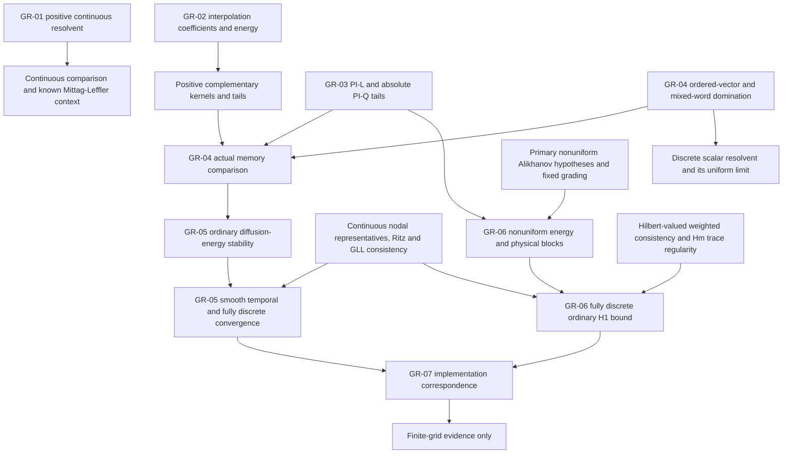

# Independent mathematical review of GR-01–GR-06

**Verdict: ACCEPT WITH LIMITATIONS for the conditional analytical results.**
The review did not find a counterexample to the stated row-tail comparison or
the stated smooth/graded convergence theorems. The graded result requires the
strong spatial-temporal hypotheses actually written in GR-06, fixed fractional
orders and fixed grading, a fixed self-adjoint diffusion operator, and the
nodal representative assumptions inherited from GR-05. It is not a regularity
theorem for arbitrary data in Sabawi et al. Numerical agreement in GR-07 is
not the justification for this verdict.

The unrestricted floating-point moment API needs repair or a narrower supported
domain; see [the implementation findings](IMPLEMENTATION_REVIEW.md). That issue
does not invalidate the exact-arithmetic quadrature formulas or the admitted
finite experiment matrix. Literature equivalence and novelty remain unresolved
where identified in [the literature comparison](LITERATURE.md).

## Sources and classification

All manuscript locators below refer to the sealed supplied `.tex` files in
[the theory directory](../../../studies/legendre/gr07/reference/theory/).
Line numbers identify the reviewed source, not an altered manuscript. No original
proof or numerical table was edited. A statement is **accepted on review** when
the analytical argument works under its written assumptions; **repair required**
identifies an incorrect statement or implementation behavior; **unresolved**
means that the available argument or source comparison does not settle it.
**Formally certified** applies only to the exact statements in
[the Lean catalogue](LEAN_CERTIFICATES.md).

| Investigation and locator | Reviewed result | Classification |
| --- | --- | --- |
| GR-01 §1, Proposition 1.1, lines 14–66 | Positive fractional resolvent, binomial series, initial majorant | Accepted on review; established comparison machinery |
| GR-01 §2, lines 67–84 | Continuous PDE energy comparison | Accepted on review under the stated testing/Caputo regularity |
| GR-01 §3, Proposition 3.1, lines 85–121 | Complementary tails and physical-time blocks | Accepted on review, conditional on positive kernels |
| GR-02 §1, lines 15–38 | Interpolation-derived increment coefficients | Accepted on review |
| GR-02 Proposition 1, lines 39–62 | Positivity, monotonicity, newest-weight gap and lower bound | Accepted on review; primary-source locators checked |
| GR-02 Proposition 2, lines 63–87 | Shifted Hilbert energy inequality | Accepted on review; scalar polarization identity formally certified |
| GR-02 Proposition 3, lines 88–107 | Complementary composition, positivity and localized mass | Accepted on review; finite conditional composition formally certified |
| GR-02 §5, lines 108–119 | Quadratic exactness and smooth derivative order $3-\alpha$ | Accepted on review, including startup |
| GR-03 §1–2, lines 14–57 | Normalization, causal stencils, mass and negative weight | Accepted on review; polynomial assembly/sign algebra formally certified |
| GR-03 Proposition 2, lines 58–86 | Consistency orders and three sharpness statements | Accepted on review, with startup/post-startup distinction |
| GR-03 Propositions 3–4, lines 87–112 | Absolute memory tails and complementary product tails | Accepted on review |
| GR-03 §5, lines 113–131 | Shifted energy and initial columns | Accepted on review |
| GR-04 Proposition 1, §1 | Ordered-vector and mixed-word domination | Accepted on review; finite algebraic core formally certified |
| GR-04 Theorem 1, §2 | Discrete resolvent and abstract-class sharpness | Accepted on review under the diagonal restriction |
| GR-04 equation (simplex bounds), Proposition 2, §3 | Shifted mixed-product estimates and uniform limit | Accepted on review; infinite limit remains analytical |
| GR-04 §4, per-step solvability and Theorem 2 | Actual PI-L/PI-Q application and finite-time $H$ stability | Accepted on review; restrictions are sufficient |
| GR-05 Theorem 1, lines 17–53 | Ordinary diffusion-energy stability and weighted dissipation | Accepted on review, fixed operator and domain assumptions retained |
| GR-05 Theorem 2, Proposition 1, lines 54–92 | Smooth temporal order two and solution-error lower bound | Accepted on review for consistently forced data |
| GR-05 §3–4, lines 93–145 | Ritz approximation, GLL consistency and complete residual | Accepted on review; exact CQ source locator remains unavailable |
| GR-05 Theorem 3, lines 146–157 | Ordinary $H^1$ convergence without time/degree coupling | Accepted on review under the strong stated smoothness |
| GR-06 §1, lines 14–32 | Nonuniform kernels, mesh orientation, stencils and localized mass | Accepted on review for fixed grading |
| GR-06 Theorem 1, lines 33–56 | Split-residual energy estimate | Accepted on review, derivation detailed below |
| GR-06 §3, lines 58–72 | Hilbert-valued complementary consistency and spatial split | Accepted on review under the stated $H^m$ regularity |
| GR-06 Theorem 2, lines 73–82 | $N^{-\min(2,\gamma\alpha)}+M^{1-m}$ in ordinary $H^1$ | Accepted on review as stated with all inherited assumptions |
| GR-04 novelty relative to general comparison theory | Equivalence to existing results | Unresolved; no novelty claim accepted |
| Arbitrary-data initial-layer regularity for the memory PDE | Whether the exact solution satisfies GR-06's assumptions | Unresolved; not established by these notes |

## GR-01: continuous comparison and the preliminary discrete argument

For bounded measurable $v$, the double integral defining $I^pI^qv$ is
absolutely integrable on a finite interval. Fubini and the beta integral give

$$
I^pI^qv=I^{p+q}v.
$$

Positivity is separate: it follows from the nonnegative kernel when $v\ge0$.
For $L=bI^p+cI^q$, the weighted supremum norm gives

$$
\|L\|_\xi\le b\xi^{-p}+c\xi^{-q}=\eta<1.
$$

Thus both the remainder $L^hy$ and the series tail tend to zero in a norm
equivalent to the ordinary supremum norm on $[0,T]$. Commutativity here is
the continuous fractional-integral composition law. Expanding $L^h$ and
grouping nonnegative terms yields the binomial Mittag–Leffler series. The
term of order zero is $a$ itself; no smoothing or continuity of arbitrary
measurable data is being inferred. For equivalence classes, conclusions hold
almost everywhere. A nondecreasing majorant needs a corresponding representative
if a pointwise conclusion is wanted. Constant data attain equality for the
integral equation, so sharpness is over the declared comparison class.

In the PDE estimate, use

$$
2|\lambda|\|K(t)\|\|u(t)\|\|u(s)\|
\le |\lambda|\kappa\bigl(\|u(t)\|^2+\|u(s)\|^2\bigr).
$$

The unnormalized memory mass is $t^r/r$, whereas its normalized fractional
integral is multiplied by $\Gamma(r)$. This gives exactly the two powers

$$
p=\alpha,\qquad q=\alpha+r,
$$

after applying $I^\alpha$. The Caputo energy and inverse identities require
the stated regularity; they are not being asserted for an arbitrary weak
solution. No positivity of the memory energy pairing is used.

For the discrete preliminary result, $PA=J$, positivity and the column lower
bound give the localized $P$-mass estimate directly. Reversing finite sums
gives the $PW$ bound. The physical block must be measured from the node
*before* the block. With maximum step at most half the block length, every
nonfinal greedy block has span at least half that length. This is enough for
a number of absorption steps bounded independently of $N$; no unproved
discrete fractional semigroup is needed.

## GR-02: coefficients, energy and consistency

Independently differentiate the quadratic through $t_{k-1},t_k,t_{k+1}$.
On a uniform panel with local coordinate $x$, it is

$$
\tau^{-1}\left[\Delta v^k+(x-\tfrac12)
(\Delta v^{k+1}-\Delta v^k)\right].
$$

Integrating this derivative and collecting *increments* yields the printed
GR-02 collection: $a_0+b_1$ at the newest step after startup,
$a_l-b_l+b_{l+1}$ in the interior, and $a_{n-1}-b_{n-1}$ at the oldest
step. At startup it is $a_0$. These are Alikhanov coefficients, not the
inconsistent endpoint L1-2 recurrence audited in CF-02.

The integral for $b_l$ has positive integrand after integration by parts.
Both $b_l$ and $a_l-b_l$ decrease with lag. Their sum therefore gives
interior monotonicity, and removal of the final $b$-term strengthens the
oldest comparison. At the newest end, concavity gives

$$
\sigma c_1<(1-\alpha)a_0\le(2\sigma-1)c_0.
$$

The positive-history representation with weights $h_j$ gives the exact
energy difference

$$
\sum_{j<n}h_j\|v_*-v^j\|^2
-A_0\theta^2\|\Delta v^n\|^2.
$$

Retaining the $j=n-1$ term leaves
$(2\sigma-1)A_0-\sigma^2A_1>0$, which follows from the stronger bound
with $\sigma A_1$. At $n=1$ the coefficient is $(2\sigma-1)A_0>0$.
This argument works in a real Hilbert space by polarization. It does not use
the invalid signed-history cancellation from ST-03.

Backward induction in the complementary recursion gives $P\ge0$.
Subtracting adjacent column sums proves $PA=J$, with the diagonal as the
base case. The consequence is $P\mathcal Dv=v^n-v^0$; it is not $PA=I$.
The lower kernel bound then proves every localized mass estimate used later.

For smooth consistency, completed-panel integration by parts has zero boundary
terms, and its error is bounded by $C\tau^3\int_0^{t_{n-1}} (t_*-s)^{-\alpha-1}ds=O(\tau^{3-\alpha})$. On the final panel, the
linear Taylor term vanishes because

$$
\frac{\sigma}{2-\alpha}-\frac12=0.
$$

This holds even at startup. The remainder uses $u'''$ only, so quadratic
exactness is justified. Alikhanov v3 Lemmas 2 and 4 match the stated
consistency and coefficient locators. The later nonuniform preprint has a
different, explicitly checked, set of locators.

## GR-03: shifted product integration

The memory rule approximates $I^r$, not the unnormalized integral.
Consequently the equation must supply $\lambda\Gamma(r)$ exactly once.
The three moment formulas follow by integrating $1,x,x^2$ against the
positive panel kernel. Expanding the forward/backward Lagrange polynomials
gives the stated weights. The final partial panel uses the full current-step
slope for PI-L and the backward stencil for PI-Q.

Both constructions are **causal implicit methods**: a completed stencil can
use the current unknown $U^n$, but neither construction uses $U^{n+1}$.
The final Caputo and PI-L panel is linear; the final PI-Q panel is backward
quadratic for $n\ge2$, and linear at $n=1$. Values beyond the shifted
evaluation point but within the current timestep are part of the implicit
solve, not an unavailable later timestep. Polynomial exactness is therefore
compatible with the implemented solve.

Partition of unity proves signed mass. On the uniform quadratic panels, the
absolute basis sum is $1+x(1-x)\le5/4$. The exact negative initial-weight
factor is $-17/231$ at $\alpha=\beta=9/10,n=2$. Hence positivity of
assembled PI-Q weights would be false; the proofs correctly use $H=|W|$.

The three sharpness claims concern different maxima:

- PI-L on $t^2$ has nonnegative panel errors; completed panels give a fixed
  positive multiple of $\tau^2$ at final time.
- PI-Q on $t^2$ has only the linear-startup error, a positive multiple of
  $\tau^{2+r}$. Thus its *uniform-in-time memory consistency* is $2+r$.
- PI-Q on $t^3$ has nonnegative $u-\Pi_2u$ on completed forward panels.
  Their $\tau^3$ lower bound cannot be cancelled by the final backward
  panel of size $O(\tau^{3+r})$. This is a post-startup order-three claim.

The Hilbert-valued interpolation bounds follow by scalar duality on each
interpolation error, followed by the positive integral. They do not require
a vector-valued mean-value theorem. Tail localization includes the extra
earlier panel of the quadratic stencil. Summation reversal then gives $PH$
tails without commuting either matrix. Column zero and shifted averaging
remain explicit in the energy equation.

## GR-04: adversarial examination of the comparison theorem

### Ordered vectors and noncommuting products

For a row $b_k\ge0$ and $v_0=0$, exact finite summation gives

$$
\sum_{k=1}^n b_kv_k
=\sum_{m=1}^n(v_m-v_{m-1})\sum_{k=m}^n b_k.
$$

The increments must be nonnegative to substitute upper tail bounds. The
Toeplitz majorants have nonnegative lag weights and preserve the cone of
nonnegative nondecreasing vectors by zero extension. In a word, positivity
of the original left operator transfers an existing inequality; the next
tail comparison is applied to the **majorant** vector, which is still in
the ordered cone. It is not applied to an arbitrary original intermediate
vector. Only the Toeplitz majorants commute in the binomial expansion.

An explicit warning example is

$$
B=\begin{pmatrix}0&0\\2&0\end{pmatrix},\quad
D=\begin{pmatrix}1&0\\1&1\end{pmatrix},\quad v=(1,0).
$$

The row-tail bounds hold, but $(Bv)_2=2>(Dv)_2=1$.
This invalidates a stronger unrestricted-vector statement, not GR-04's
ordered-vector proposition. The new exact rational diagnostic also checks
noncommuting originals and failures of entrywise domination.

### Diagonal and infinite-series reasoning

For finite causal matrices, the diagonal bounds imply spectral radius below
one when $\rho_\tau<1$. This proves convergence of each finite Neumann
series, but alone would not prove a mesh-uniform bound. GR-04 supplies the
additional argument: for a word of length $h$, the cell-box union is bounded
between simplices of lengths

$$
t_n-\tau\quad\hbox{and}\quad t_n+(h-1)\tau.
$$

The upper shift cannot be discarded. The beta simplex integral has factor
$\prod_i\Gamma(1+s_i)/\Gamma(1+\sum_i s_i)$, matching the manuscript.
Under its stronger $\xi$-restriction, the sum of all length-$h$ upper
terms is at most $e^{\xi t_n}(e^{\xi\tau}\eta)^h$, a uniform geometric
bound. Fixed-length simplex bounds converge uniformly in the grid-node
index; the geometric tail justifies passage through the infinite series.
There is no exchange based solely on pointwise convergence of the terms.

The exact scalar resolvent exists under the weaker diagonal hypothesis;
the shifted analytical upper series is only asserted when it converges.
Sharpness follows from taking $B_i=D_i$ and constant data in the abstract
class. It does not say the energy bound is attained by a PDE trajectory or
is optimal for the narrower class of actual memory matrices.

### Application and domains

After $P$ is applied, the actual nonnegative matrices are $bPS_+$ and
$\mu PH_+$; neither $W^Q\ge0$ nor commutativity is required. Initial
columns remain data. The solvability factorization uses

$$
R_n=(a_{nn}I+\sigma A)^{-1}:H\longrightarrow D(A),\qquad
M_n=(I+\lambda\Gamma(r)W_{nn}K_nR_n)(a_{nn}I+\sigma A).
$$

The first factor is a bounded invertible map on $H$ under the stated small
perturbation bound; the second is invertible from $D(A)$ to $H$.
Induction needs $U^0\in D(A)$, as specified. No invariance of $D(A)$
under $K_n$ is assumed. The timestep restrictions are sufficient; violating
them is not evidence of instability or nonexistence.

## GR-05: ordinary energy and direct spatial residual

Testing by $Av_*$ is legitimate for the existing sequence in $D(A)$.
For $x,y\in D(A)$,

$$
(x,Ay)=(A^{1/2}x,A^{1/2}y).
$$

Thus finite temporal combinations commute with the fixed $A^{1/2}$ in
the form pairing. No assumption $v\in D(A^{3/2})$ is needed. With
$h=g-\lambda\Gamma(r)KQv$, GR-04 and absolute memory mass bound $h$
in $H$, and Young's inequality gives

$$
\mathcal D\|A^{1/2}v\|^2+\|Av_*\|^2\le\|h\|^2.
$$

Applying $P$ yields the stated complementary-weighted dissipation and
ordinary diffusion-energy bound. It does not bound every $Av^n$
pointwise, and it does not work unchanged for a time-dependent $A_n$.

The smooth temporal residual has three terms: derivative, shifted diffusion,
and memory. Graph-norm control of $u''$ is essential for the diffusion
term. Both full schemes are order two despite the better post-startup PI-Q
memory consistency. The $t^2$ lower bound does not need positivity of a
solution trajectory: the residual is positive, then the **absolute value of
the complementary-summed error equation** bounds its magnitude by

$$
\max|e|\left[1+(a+\lambda\Gamma(r)J_X)\sum_jP_{Nj}\right].
$$

The exact linear derivative gives the positive lower $P$-mass bound. This
avoids a false monotone-inverse argument for the shifted diffusion scheme.
The example is consistently forced, not a homogeneous counterexample.

For the spatial result, integrating the degree-$M-1$ $L^2$-projection of
$u_x$ constructs the derivative Ritz map. Retaining constants preserves
the second endpoint boundary value. The $H^1\to C$ embedding controls the
nodal error. Integrating the degree-$M-2$ projection of $g_x$ gives a
degree-$M-1$ comparison polynomial, so its product with $w\in V_M$
is within GLL exactness. The remaining defect is bounded by the approximation
error, not declared zero for variable coefficients.

The approximation input can also be checked directly rather than relying on
an unavailable source locator. Write $f=\sum a_kP_k$. Weighted orthogonality
of the derivatives of the Legendre polynomials, followed by integration by
parts and Bessel's inequality, gives for integer $s\ge1$

$$
\sum_{k\ge s}\frac{2}{2k+1}\frac{(k+s)!}{(k-s)!}|a_k|^2
\le \int_{-1}^1(1-x^2)^s|f^{(s)}(x)|^2\,dx.
$$

For smooth $f$, the integration-by-parts boundary terms vanish because of
the factor $(1-x^2)^s$; density extends the estimate to $H^s$. The reciprocal
factorial ratio on a degree-$L$ tail is bounded by $C_s(L+1)^{-2s}$.
Therefore $\|f-\Pi_Lf\|_{L^2}\le C_s(L+1)^{-s}\|f\|_{H^s}$.
Taking $f=u_x$ or $g_x$, $s=m-1$, and integrating the projected derivative
gives precisely the two approximation inputs above, with small degrees
absorbed in a constant depending on fixed $m$. This checks the required
rate independently; it does not fabricate a theorem number in CQ.

The GLL norm of a degree-$M$ polynomial differs from its continuous norm
only in the squared top Legendre mode; its ratio is bounded independently
of $M$. Hence the discrete energy norm is uniformly equivalent to ordinary
$H^1$. Every nonpolynomial nodal evaluation uses a continuous representative,
and multiplier bounds provide uniform pointwise bounds on those actual values.
Essential bounds alone on an arbitrarily modified equivalence class would
not suffice.

In the direct residual equation, Ritz orthogonality cancels stiffness
projection exactly. The derivative projection is
$(\mathcal R_M-I)\mathcal D u$, whose size is bounded by applying the
projection estimate to the bounded $H^m$ temporal derivative; a separate
$\tau^{-\alpha}$ factor would be an incorrect loss. Integrating by parts
in the shifted stiffness residual uses $u''\in H^2$ and avoids an inverse
inequality. The resulting Riesz residual is $O(\tau^2+M^{1-m})$ in the
GLL Hilbert norm. GR-05's stability constant is independent of the spectrum
of $A_M$, so no hidden timestep/degree coupling appears. The exact primary
locator for the standard Legendre approximation input could not be checked
because the publisher blocked the PDF; that source limitation is retained.

## GR-06: highest-risk chain

### Primary-source hypotheses and graded geometry

The exact primary source is [Liao–McLean–Zhang v4](literature/liao-mclean-zhang-1803.09873v4.pdf).
Its Theorem 2.2 and Corollary 2.3 use the ratio
$\rho_k=\tau_k/\tau_{k+1}\le7/4$, with offset $\theta=\alpha/2$.
The graded mesh has $\rho_k\le1$. The lower cell-average kernel bound
implies the stated $4/[11\Gamma(1-\alpha)]$ pointwise lower constant.
The mesh also satisfies the source's graded regularity condition M2, with
constants depending on the fixed grading exponent.

The nonuniform forward stencil has local nodes (0,1,1+R), $R\ge1$.
The final backward memory stencil has nodes $-\rho,0,1$. Its absolute
basis sum is $1+2x(1-x)/[\rho(1+\rho)]$ on $0\le x\le1$.
The stated positive lower bound on adjacent ratios for fixed $\gamma$
therefore gives a finite, generally large, Lebesgue constant. It is not the
uniform-grid (5/4) constant. Since steps are nondecreasing, the extra
earlier support panel has length at most the tail span. The stated $2^r$
localization factor and the $PH_+$ bound follow. These constants are not
uniform in $\gamma$.

### Split residual without squaring the singular defect

For $v\in D(A)$, $g\in V=D(A^{1/2})$, testing by $2(v_*+Av_*)$
uses the form identity

$$
(g,v_*+Av_*)=(g,v_*)+(A^{1/2}g,A^{1/2}v_*).
$$

Let $L=\max_n\|v^n\|_V$. This term is bounded by
$L\|g\|_V$, before the factor two. Treat $h\in H$ and the memory
by Young's inequality, reserving part of $2\|Av_*\|^2$ to absorb their
operator-pairing terms. Weighted Cauchy–Schwarz bounds the squared memory by
$\mu^2J_X\sum H_{nk}E_k$. The result is precisely

$$
\mathcal D E\le CSE+CHE+C\|h\|^2+2L\|g\|_V.
$$

After applying $P$, the two row-tail powers admit physical-time block
absorption. Its constant depends on fixed parameters and $T$, not the
number of blocks growing with $N$. One obtains

$$
L^2\le C\left(E_0+\max\|h\|^2+L\max_n\sum_{j\le n}P_{nj}\|g_j\|_V\right).
$$

Scalar Young absorption of the final *linear* term in $L$ proves Theorem 1.
Replacing it by a maximum of squared local Caputo defects would lose the
claimed estimate and is not done here. No spatial derivative of $K_n$ is
needed for this abstract energy step.

### Hilbert-valued consistency and the endpoint rate

The stated $H^m$-valued derivative bounds imply absolute continuity in
$H^m$: $\|u'(t)\|_{H^m}\le C(1+t^{\alpha-1})$ is integrable.
Consequently

$$
\|{}^CD_t^\alpha u(t)\|_{H^m}
\le \frac C{\Gamma(1-\alpha)}
\int_0^t(t-s)^{-\alpha}(1+s^{\alpha-1})\,ds\le C_T.
$$

The zero boundary trace is preserved under differentiation at positive times,
finite temporal sums, and the Bochner integral. Therefore $R_D\in H^m\cap H_0^1$ and its Ritz projection is well-defined. This trace point
should be made explicit in a consolidated manuscript.

The source's Lemma 3.6 is a scalar result. Its extension needed here can be
checked at the **error-convolution-structure bound**, rather than by
interchanging a supremum with a sum of scalar errors. Replace each scalar
third derivative in the local and history integral remainders by its Bochner
norm. All bounding kernels are nonnegative. The same remainder estimates
and finite summation identities then give

$$
\|R_D^j\|_{H^m}\le A_{jj}G_{\rm loc}^j+
\sum_{k<j}(A_{j,k+1}-A_{jk})G_{\rm his}^k.
$$

Applying nonnegative $P$ gives the same weighted bound as in the scalar
proof. At zero, the integrands involving $s^2u'''(s)$ have size
$O(s^{\alpha-1})$, so the improper integrals converge. Integral
remainders can first be used away from zero and then passed to the limit;
no vector-valued mean-value theorem is needed. This establishes the
extension under GR-06's written regularity, rather than attributing an
$H^m$ PDE theorem to the primary paper.

For graded nodes the non-startup maximum in that lemma has scaling

$$
\frac{t_k^\alpha t_{k-1}^{\alpha-3}\tau_k^3}{\tau_{k-1}^\alpha}
\le C N^{-\gamma\alpha} k^{\gamma\alpha-(3-\alpha)}.
$$

Taking a maximum yields $N^{-\min(\gamma\alpha,3-\alpha)}$.
It is not a sum of $k^{-1}$; at equality the maximum is constant, so this
argument has no endpoint logarithm. Startup contributes $N^{-\gamma\alpha}$.
The constants include factors depending on $\alpha$ and $1-\alpha$;
no order-robust estimate is established here.

For PI-L and PI-Q, stencils touching zero use the $t^\alpha$ variation
bound. Elsewhere the earliest positive node and adjacent step sizes are
comparable, with constants depending on fixed $\gamma$. Subtracting an
affine Taylor polynomial bounds interpolation by
$C\tau_k^2(1+t_{k-1}^{\alpha-2})$. This yields the sufficient uniform
rate $N^{-s}$, $s=\min(2,\gamma\alpha)$, for both memory rules.
The same estimate applies to the shifted stiffness residual in $L^2$
because $m\ge2$.

Finally split the derivative residual as written in GR-06:

$$
\mathcal D\mathcal R_Mu-{}^CD_t^\alpha u
=\mathcal R_MR_D+(\mathcal R_M-I){}^CD_t^\alpha u.
$$

Assign the first term to $g$; Ritz stability and GLL equivalence bound its
energy norm by $C\|R_D\|_{H^m}$, with no factor depending on $M$.
Assign the second and all remaining Riesz residuals to $h$. The bounded
exact Caputo derivative, multiplier assumption, nodal representatives,
quadrature estimate and integrated-by-parts stiffness residual give
$\max\|h\|_M\le C(M^{1-m}+N^{-s})$. Since $3-\alpha>2$, the
complementary-weighted $g$ rate is at least as good as $N^{-s}$.

**Conclusion:** the displayed ordinary $H^1$ bound is justified under
the exact strong hypotheses stated in GR-06 and inherited from GR-05.
No temporal-spatial coupling is introduced by this chain. The critical
grading $\gamma=2/\alpha$ attains order two without a logarithmic loss
in this argument. This does not establish those hypotheses for arbitrary
initial data, weaken them to $L^2$-only residual regularity, extend to a
varying unbounded diffusion operator, or certify an asymptotic numerical rate
from a finite window.

## Dependency graph and consequences of a failed input

Failure of GR-04 word domination would remove its quantitative resolvent
comparison; the separate physical-block finite-time route would still need
to be assessed on its own. Failure of coefficient positivity or the shifted
energy inequality would undermine both routes. Failure of $H^m$ weighted
consistency would remove the ordinary $H^1$ graded conclusion; GR-07 finite
agreement could not repair it. Failure of continuous nodal representatives
would invalidate the nodal coefficient and quadrature applications even when
essential bounds held. The discovered floating-point boundary failures affect
computations in that range, not these exact-arithmetic implications.

## Counterexamples, unresolved obligations and manuscript requirements

| ID | Finding or obligation | Consequence and required treatment |
| --- | --- | --- |
| AUD02-C1 | Tail domination fails on the explicit decreasing vector above | Accepted counterexample to an overstrong extension; keep the ordered-cone hypothesis in GR-04 and all applications |
| AUD02-C2 | PI-Q’s assembled initial weight has normalized factor (-17/231) | Formally certified algebra; retain absolute memory matrices in GR-03–06 |
| AUD02-C3 | Three generic moment boundary probes fail | Repair required before claiming validity over all inputs admitted by the routine's guards; [details](IMPLEMENTATION_REVIEW.md#moment-boundary-counterexamples) |
| AUD02-U1 | GR-04 equivalence/novelty relative to general positive-kernel and discrete Volterra comparisons | Unresolved; remove any implication of established novelty, not the proved comparison |
| AUD02-U2 | Regularity of arbitrary exact memory-PDE solutions | Unresolved; the graded theorem is conditional, not an existence/regularity theorem |
| AUD02-U3 | Exact primary CQ theorem locator | Unresolved source check after publisher HTTP 403; do not invent a locator |
| AUD02-L1 | All fractional orders, grading and data norms are fixed | Constants and fine-grid thresholds need not be uniform as orders approach endpoints or grading increases |
| AUD02-L2 | Finite-grid rates and implementation benchmarks | Retain their measured scope; no infinite-grid or intrinsic efficiency conclusion |

A future consolidated manuscript should retain the distinctions above,
include the Hilbert-valued error-convolution and trace justification, explicitly
state $U^0\in D(A)$ in the abstract solvability/energy statements, and carry
the current operator and pointwise nodal hypotheses into every application.
It should separate the smooth forced lower bound from homogeneous initially
singular AUD-01 evidence, and keep the quantifier qualifications concerning
Sabawi Theorems 3.1–3.2. GR-01–06 establish results for a different shifted
method; they do not retrospectively validate the printed L1-2 recurrence.

No original manuscript was changed to implement these editorial requirements.
